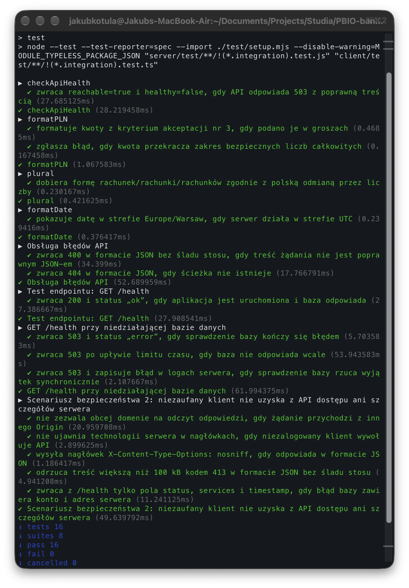
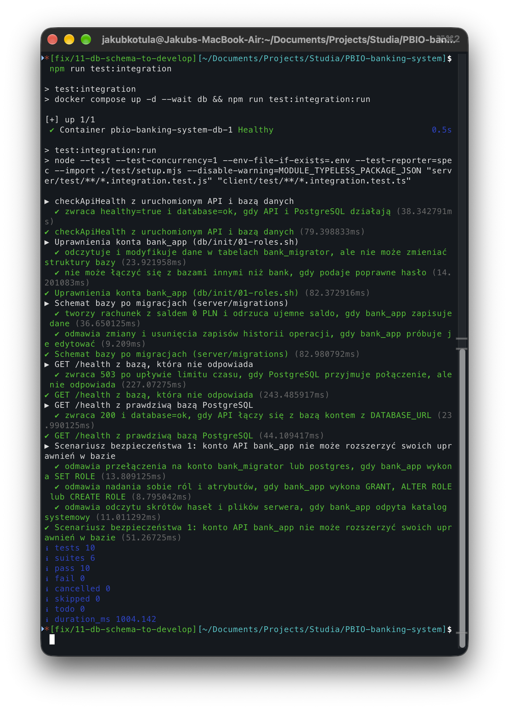
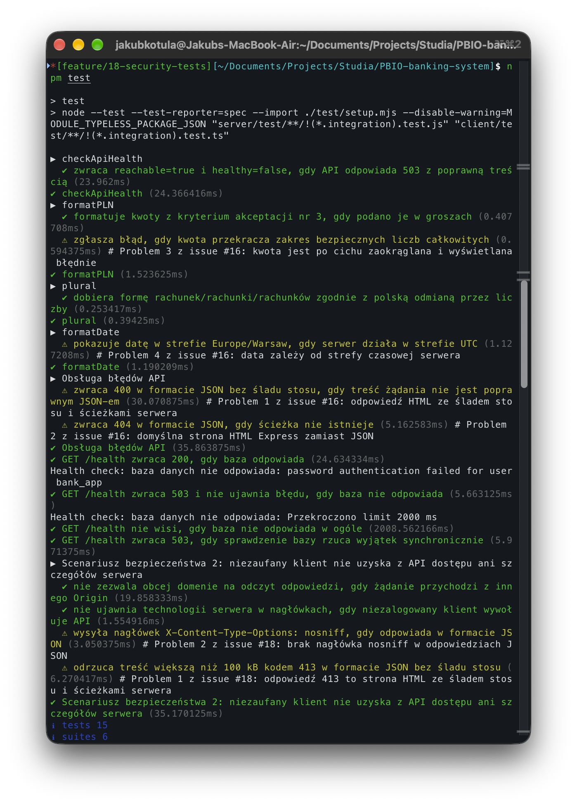
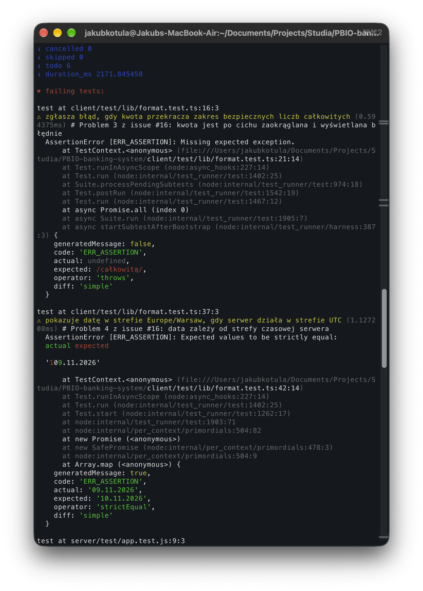
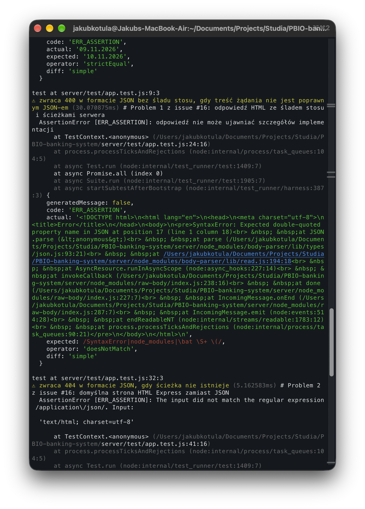

# Raport z wyników testów – System bankowy PBIO (etap 3)

| | |
|---|---|
| **Data uruchomienia** | 25.11.2026 |
| **Gałąź / wersja** | `develop` po scaleniu issue #18, #19 i schematu bazy z PR #12 |
| **Narzędzie** | `node:test` + `node:assert/strict` (wbudowane w Node.js) |
| **Środowisko** | Node.js 24.22.1, macOS, PostgreSQL 17 (`postgres:17-alpine` z `docker-compose.yml`) |
| **Polecenie** | `npm run test:all` (= `npm test` + `npm run test:integration`) |
| **Wynik** | **26 / 26 testów zaliczonych**, 0 niezaliczonych, 0 oznaczonych jako znany błąd (`todo`) |

## 1. Podsumowanie

| Rodzaj testu | Wymagane | Zrealizowane | Zaliczone | Czas |
|---|---|---|---|---|
| Testy jednostkowe | 8 | 10 | 10 | |
| Test endpointu | 1 | 1 | 1 | |
| Scenariusze bezpieczeństwa | 2 | 2 (8 testów) | 8 | |
| Testy integracyjne | 5 | 7 | 7 | |
| **Razem** | | **26 testów** | **26** | `npm test` ≈ 0,2 s, integracyjne ≈ 0,9 s |

`npm test` uruchamia 16 testów: jednostkowe, test endpointu i scenariusz bezpieczeństwa 2. `npm run test:integration` uruchamia 10 testów: integracyjne i scenariusz bezpieczeństwa 1, który wymaga bazy danych.

Dodatkowo obie aplikacje Next.js przechodzą `npm run lint` i `npm run build` bez błędów (sekcja 3).

## 2. Opis wykonanych testów

### 2.1. Testy jednostkowe (10)

Sprawdzają pojedyncze funkcje bez bazy danych i bez sieci. Zależności, takie jak sprawdzenie bazy czy `fetch`, są podmieniane atrapami.

| # | Plik › blok | Nazwa testu | Co sprawdza | Dane |
|---|---|---|---|---|
| J1 | `client/test/lib/format.test.ts` › `formatPLN` | formatuje kwoty z kryterium akceptacji nr 3, gdy podano je w groszach | zamiana groszy na tekst „74,50 PLN” bez arytmetyki zmiennoprzecinkowej | poprawne: 10 000, 7 450, 2 550, 0 gr |
| J2 | › `formatPLN` | zgłasza błąd, gdy kwota przekracza zakres bezpiecznych liczb całkowitych | kwota, której nie da się dokładnie zapisać w typie `number`, jest odrzucana, a nie zaokrąglana | błędne: 2⁵³ + 1 gr |
| J3 | › `plural` | dobiera formę rachunek/rachunki/rachunków zgodnie z polską odmianą przez liczby | odmiana przez liczby, w tym przypadki brzegowe 12–14, 22, 112 | 0–112 |
| J4 | › `formatDate` | pokazuje datę w strefie Europe/Warsaw, gdy serwer działa w strefie UTC | data nie zależy od strefy czasowej serwera | 23:30 UTC 9.11 → 10.11.2026 |
| J5 | `client/test/lib/api-health.test.ts` › `checkApiHealth` | zwraca reachable=true i healthy=false, gdy API odpowiada 503 z poprawną treścią | odczyt odpowiedzi `/health` przez aplikację klienta, adres żądania | atrapa `fetch` → 503 |
| J6 | `server/test/app.test.js` › Obsługa błędów API | zwraca 400 w formacie JSON bez śladu stosu, gdy treść żądania nie jest poprawnym JSON-em | odpowiedź na uszkodzone żądanie nie ujawnia implementacji | błędne: `{"amount": 25.50,` |
| J7 | › Obsługa błędów API | zwraca 404 w formacie JSON, gdy ścieżka nie istnieje | spójny format odpowiedzi API | nieistniejąca ścieżka |
| J8 | `server/test/health.test.js` › GET /health przy niedziałającej bazie danych | zwraca 503 i status „error”, gdy sprawdzenie bazy kończy się błędem | reakcja `/health` na błąd bazy | atrapa: `ECONNREFUSED` |
| J9 | › GET /health przy niedziałającej bazie danych | zwraca 503 po upływie limitu czasu, gdy baza nie odpowiada wcale | endpoint nie zawiesza się – odpowiada po limicie czasu | atrapa: obietnica, która się nie kończy; limit 50 ms |
| J10 | › GET /health przy niedziałającej bazie danych | zwraca 503 i zapisuje błąd w logach serwera, gdy sprawdzenie bazy rzuca wyjątek synchronicznie | wyjątek synchroniczny nie przerywa obsługi żądania, a błąd trafia do logów | atrapa: `throw` |

### 2.2. Test endpointu (1)

| # | Plik › blok | Nazwa testu | Co sprawdza |
|---|---|---|---|
| E1 | `server/test/health.test.js` › Test endpointu: GET /health | zwraca 200 i status „ok”, gdy aplikacja jest uruchomiona i baza odpowiada | aplikacja Express jest uruchamiana na losowym porcie i odpytywana przez HTTP. Wymagany kod `200`, `"status": "ok"`, `services: {api: ok, database: ok}`, poprawny `timestamp` i nagłówek `Cache-Control: no-store` |

Ten sam endpoint z prawdziwą bazą PostgreSQL sprawdza test integracyjny I2.

### 2.3. Scenariusze bezpieczeństwa (2 scenariusze, 8 testów)

**Scenariusz 1 – konto API `bank_app` nie może rozszerzyć swoich uprawnień w bazie**
(`server/test/security/db-privileges.integration.test.js`, z prawdziwą bazą)

Zagrożenie: atakujący przejmuje API (np. przez błąd w kodzie albo wyciek `DATABASE_URL`) i działa z uprawnieniami konta `bank_app`. Wymaganie z REQUIREMENTS.md: „Konto bazy używane przez API ma minimalny niezbędny zakres uprawnień”.

| # | Nazwa testu | Próba ataku | Oczekiwany wynik |
|---|---|---|---|
| B1.1 | odmawia przełączenia na konto bank_migrator lub postgres, gdy bank_app wykona SET ROLE | `SET ROLE bank_migrator`, `SET ROLE postgres` | `permission denied to set role` |
| B1.2 | odmawia nadania sobie ról i atrybutów, gdy bank_app wykona GRANT, ALTER ROLE lub CREATE ROLE | `GRANT bank_migrator TO bank_app`, `ALTER ROLE bank_app SUPERUSER`, `CREATE ROLE … SUPERUSER` | odmowa dla każdego polecenia |
| B1.3 | odmawia odczytu skrótów haseł i plików serwera, gdy bank_app odpyta katalog systemowy | `SELECT rolpassword FROM pg_authid`, `pg_read_file(…)`, `COPY … TO PROGRAM` | odmowa dla każdego polecenia |

**Scenariusz 2 – niezaufany klient nie uzyska z API dostępu ani szczegółów serwera**
(`server/test/security/api-access-control.test.js`, bez bazy)

Zagrożenie: niezalogowany użytkownik albo obca strona internetowa próbuje odczytać odpowiedzi API z przeglądarki ofiary, rozpoznać technologię serwera lub przeciążyć API dużym żądaniem. Wymaganie: kryterium akceptacji nr 10 i punkt „Dane … nie mogą być udostępniane … przez komunikaty błędów ani publiczne endpointy”.

| # | Nazwa testu | Próba ataku | Oczekiwany wynik |
|---|---|---|---|
| B2.1 | nie zezwala obcej domenie na odczyt odpowiedzi, gdy żądanie przychodzi z innego Origin | `Origin: https://evil.example` | brak `Access-Control-Allow-Origin` i `…-Allow-Credentials` |
| B2.2 | nie ujawnia technologii serwera w nagłówkach, gdy niezalogowany klient wywołuje API | rozpoznanie serwera | brak `X-Powered-By` |
| B2.3 | wysyła nagłówek X-Content-Type-Options: nosniff, gdy odpowiada w formacie JSON | MIME sniffing | `X-Content-Type-Options: nosniff` |
| B2.4 | odrzuca treść większą niż 100 kB kodem 413 w formacie JSON bez śladu stosu | żądanie 150 kB | `413`, JSON, brak śladu stosu i ścieżek |
| B2.5 | zwraca z /health tylko pola status, services i timestamp, gdy błąd bazy zawiera konto i adres serwera | wymuszony błąd bazy z nazwą konta, hostem i portem | tylko 3 pola, bez treści błędu. Błąd trafia do logów serwera |

### 2.4. Testy integracyjne (7)

Sprawdzają współpracę kilku części systemu z prawdziwą bazą PostgreSQL. Tworzą tylko tymczasowe tabele o unikalnych nazwach (`it_test_…`) i usuwają je po sobie albo działają w transakcji wycofywanej na końcu testu.

| # | Plik › blok | Nazwa testu | Współpracujące elementy |
|---|---|---|---|
| I1 | `client/test/integration/api-health.integration.test.ts` › checkApiHealth z uruchomionym API i bazą danych | zwraca healthy=true i database=ok, gdy API i PostgreSQL działają | aplikacja klienta (Next.js) → HTTP → Express → pula `pg` → PostgreSQL |
| I2 | `server/test/integration/health.integration.test.js` › GET /health z prawdziwą bazą PostgreSQL | zwraca 200 i database=ok, gdy API łączy się z bazą kontem z DATABASE_URL | Express → `db/pool.js` → PostgreSQL (konto `bank_app`) |
| I3 | `server/test/integration/health-unresponsive-database.integration.test.js` › GET /health z bazą, która nie odpowiada | zwraca 503 po upływie limitu czasu, gdy PostgreSQL przyjmuje połączenie, ale nie odpowiada | Express → `db/pool.js` → serwer TCP, który nie odpowiada |
| I4 | `server/test/integration/db-roles.integration.test.js` › Uprawnienia konta bank_app | odczytuje i modyfikuje dane w tabelach bank_migrator, ale nie może zmieniać struktury bazy | `db/init/01-roles.sh`: tabela tworzona przez `bank_migrator`, operacje CRUD i odmowy DDL dla `bank_app` |
| I5 | › Uprawnienia konta bank_app | nie może łączyć się z bazami innymi niż bank, gdy podaje poprawne hasło | `db/init/01-roles.sh`: brak dostępu do `postgres` i `template1` |
| I6 | `server/test/integration/db-schema.integration.test.js` › Schemat bazy po migracjach | tworzy rachunek z saldem 0 PLN i odrzuca ujemne saldo, gdy bank_app zapisuje dane | runner migracji (`src/db/migrate.js`) → schemat `001_initial_schema.sql` → zapis kontem `bank_app` i ograniczenie `CHECK` salda |
| I7 | › Schemat bazy po migracjach | odmawia zmiany i usunięcia zapisów historii operacji, gdy bank_app próbuje je edytować | migracja odbiera `bank_app` prawa `UPDATE`/`DELETE` do `ledger_entries` – historia operacji jest niemodyfikowalna |

## 3. Wykryte i poprawione błędy

Testy przygotowane w issue #16, #17 i #18 oraz sprawdzenie lint/build przed oddaniem wykryły poniższe błędy. Do czasu poprawki takie testy miały opcję `todo`. Wszystkie błędy poprawiono w issue #19 i usunięto opcję `todo`, więc te same testy pilnują teraz, żeby błędy nie wróciły.

| Problem | Wykrył test | Opis błędu | Poprawka |
|---|---|---|---|
| #16 / 1 | J6 | uszkodzony JSON → strona HTML ze śladem stosu i ścieżkami serwera | obsługa błędów w `server/src/app.js` zwraca JSON `{"error": "…"}` bez szczegółów |
| #16 / 2 | J7 | nieistniejąca ścieżka → domyślna strona HTML Express | obsługa 404 w formacie JSON |
| #16 / 3 | J2 | kwota > 2⁵³ − 1 gr po cichu zaokrąglana i błędnie wyświetlana | `Number.isSafeInteger` w `formatPLN` (`client/` i `admin/`) |
| #16 / 4 | J4 | data zależna od strefy czasowej serwera (UTC → 9.11 zamiast 10.11) | `timeZone: "Europe/Warsaw"` w `formatDate`/`formatDateTime` (`client/` i `admin/`) |
| #17 / 1 | I5 | `bank_app` mógł łączyć się z bazami `postgres` i `template1` | `REVOKE CONNECT … FROM PUBLIC` w `db/init/01-roles.sh` |
| #18 / 1 | B2.4 | odpowiedź 413 to strona HTML ze śladem stosu | ta sama obsługa błędów co w #16/1 |
| #18 / 2 | B2.3 | brak `X-Content-Type-Options: nosniff` | nagłówek dodawany do każdej odpowiedzi API |
| #18 / 3 | J9, I3 | test limitu czasu czekał 2 s (≈ 90% czasu `npm test`) | opcja `healthTimeoutMs` w `createApp`; testy używają 50–200 ms. `npm test`: 2,2 s → 0,2 s |
| #18 / 4 | J8, J9 | logi `console.error` zaśmiecały raport testów | logi w testach są wyciszane atrapą `t.mock.method(console, "error")` |
| #18 / 5 | E1, J8–J10 | testy `/health` bez bloku `describe`, nieprecyzyjna nazwa „nie wisi”, test endpointu nieoznaczony | podział na bloki „Test endpointu: GET /health” i „GET /health przy niedziałającej bazie danych”, nowe nazwy |
| #18 / 6 | B2.5 | test wycieku sprawdzał tylko słowo `password` | test sprawdza dokładny zestaw pól oraz brak nazwy konta, hosta i portu |
| schemat | I6, I7 | schemat bazy i runner migracji z PR #12 trafiły do `feature/3-postgres-setup` zamiast do `develop` – na `develop` baza nie miała tabel | scalenie `feature/3-postgres-setup` do `develop`. Migracje wykonują się przy starcie serwera |
| build | `npm run build` | `next build` kończył się błędem w obu aplikacjach: strona `/status` pobierała dane z czasu żądania poza `<Suspense>` (wymagane przy `cacheComponents`) | treść strony w `<Suspense>` z komunikatem „Sprawdzanie połączenia…” |
| build | `npm audit` | Next.js 16.4.3 ze znaną podatnością (moderate) – `next build` losowo przerywał się z `SecurityFatalError` | `next` i `eslint-config-next` 16.4.6. `npm audit`: 0 podatności |

## 4. Wyniki uruchomienia

### 4.1. `npm test`



```
▶ checkApiHealth
  ✔ zwraca reachable=true i healthy=false, gdy API odpowiada 503 z poprawną treścią
▶ formatPLN
  ✔ formatuje kwoty z kryterium akceptacji nr 3, gdy podano je w groszach
  ✔ zgłasza błąd, gdy kwota przekracza zakres bezpiecznych liczb całkowitych
▶ plural
  ✔ dobiera formę rachunek/rachunki/rachunków zgodnie z polską odmianą przez liczby
▶ formatDate
  ✔ pokazuje datę w strefie Europe/Warsaw, gdy serwer działa w strefie UTC
▶ Obsługa błędów API
  ✔ zwraca 400 w formacie JSON bez śladu stosu, gdy treść żądania nie jest poprawnym JSON-em
  ✔ zwraca 404 w formacie JSON, gdy ścieżka nie istnieje
▶ Test endpointu: GET /health
  ✔ zwraca 200 i status „ok”, gdy aplikacja jest uruchomiona i baza odpowiada
▶ GET /health przy niedziałającej bazie danych
  ✔ zwraca 503 i status „error”, gdy sprawdzenie bazy kończy się błędem
  ✔ zwraca 503 po upływie limitu czasu, gdy baza nie odpowiada wcale
  ✔ zwraca 503 i zapisuje błąd w logach serwera, gdy sprawdzenie bazy rzuca wyjątek synchronicznie
▶ Scenariusz bezpieczeństwa 2: niezaufany klient nie uzyska z API dostępu ani szczegółów serwera
  ✔ nie zezwala obcej domenie na odczyt odpowiedzi, gdy żądanie przychodzi z innego Origin
  ✔ nie ujawnia technologii serwera w nagłówkach, gdy niezalogowany klient wywołuje API
  ✔ wysyła nagłówek X-Content-Type-Options: nosniff, gdy odpowiada w formacie JSON
  ✔ odrzuca treść większą niż 100 kB kodem 413 w formacie JSON bez śladu stosu
  ✔ zwraca z /health tylko pola status, services i timestamp, gdy błąd bazy zawiera konto i adres serwera
ℹ tests 16
ℹ suites 8
ℹ pass 16
ℹ fail 0
ℹ todo 0
ℹ duration_ms ≈ 210
```

### 4.2. `npm run test:integration`



```
▶ checkApiHealth z uruchomionym API i bazą danych
  ✔ zwraca healthy=true i database=ok, gdy API i PostgreSQL działają
▶ Uprawnienia konta bank_app (db/init/01-roles.sh)
  ✔ odczytuje i modyfikuje dane w tabelach bank_migrator, ale nie może zmieniać struktury bazy
  ✔ nie może łączyć się z bazami innymi niż bank, gdy podaje poprawne hasło
▶ Schemat bazy po migracjach (server/migrations)
  ✔ tworzy rachunek z saldem 0 PLN i odrzuca ujemne saldo, gdy bank_app zapisuje dane
  ✔ odmawia zmiany i usunięcia zapisów historii operacji, gdy bank_app próbuje je edytować
▶ GET /health z bazą, która nie odpowiada
  ✔ zwraca 503 po upływie limitu czasu, gdy PostgreSQL przyjmuje połączenie, ale nie odpowiada
▶ GET /health z prawdziwą bazą PostgreSQL
  ✔ zwraca 200 i database=ok, gdy API łączy się z bazą kontem z DATABASE_URL
▶ Scenariusz bezpieczeństwa 1: konto API bank_app nie może rozszerzyć swoich uprawnień w bazie
  ✔ odmawia przełączenia na konto bank_migrator lub postgres, gdy bank_app wykona SET ROLE
  ✔ odmawia nadania sobie ról i atrybutów, gdy bank_app wykona GRANT, ALTER ROLE lub CREATE ROLE
  ✔ odmawia odczytu skrótów haseł i plików serwera, gdy bank_app odpyta katalog systemowy
ℹ tests 10
ℹ suites 6
ℹ pass 10
ℹ fail 0
ℹ todo 0
ℹ duration_ms ≈ 860
```

### 4.3. Stan przed poprawkami (issue #18)

Dla porównania: przed issue #19 `npm test` zgłaszał 15 testów, z czego 6 jako znane błędy (`⚠ … # Problem N z issue #NN`), a `npm run test:integration` – 1 znany błąd.



Szczegóły niezaliczonych asercji, np. odpowiedź HTML ze śladem stosu zamiast JSON i data 09.11 zamiast 10.11:





## 5. Ograniczenia

- API nie ma jeszcze uwierzytelniania ani endpointów rachunków i przelewów (schemat bazy już jest). Scenariuszy typu „użytkownik A odczytuje lub obciąża rachunek użytkownika B” (kryterium akceptacji nr 2) nie da się jeszcze przetestować. Trzeba je dodać razem z implementacją (issue #20).
- Testy integracyjne korzystają z lokalnej bazy deweloperskiej `bank` z Dockera, nie z bazy produkcyjnej. Tworzą wyłącznie tymczasowe tabele i usuwają je po sobie.
- Komponenty React (formularz logowania, strony) nie są objęte testami automatycznymi.
